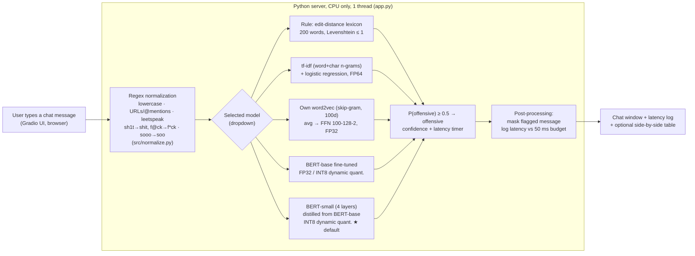

# Real-Time Chat Moderation (SWE015 Homework, Use Case 4)

A gaming-chat moderator that labels every message **clean / offensive** live on a **CPU-only** server
within a **50 ms per message** budget. Flagged messages are masked. A side panel logs the response
time of every message and lets you switch between seven models.

The deployed model is a **BERT-small distilled from fine-tuned BERT-base, then INT8-quantized**.

## Setup and run

```bash
git clone https://github.com/Mahmut-Ornek/realtime-chat-moderation.git
cd realtime-chat-moderation
python -m venv .venv && .venv\Scripts\activate          # Linux/macOS: source .venv/bin/activate
pip install -r requirements.txt
python app.py                                            # opens http://127.0.0.1:7860
```

On the first run, `app.py` downloads the trained weights (about 780 MB) from the Hugging Face Hub:
[mahmut-ornek/realtime-chat-moderation-models](https://huggingface.co/mahmut-ornek/realtime-chat-moderation-models).
Weights are not stored in this repository.

To **reproduce everything from scratch** (about 10–15 min on a GPU):

```bash
python -m src.train_all      # trains all models, quantizes, distills, then runs src.evaluate
python -m src.evaluate       # only the test-set evaluation -> results/results.md
```

## Data

[OffensEval-2019 (OLID), English](https://sites.google.com/site/offensevalsharedtask/olid) (Zampieri et al., 2019),
loaded from the Hugging Face Hub as the `offensive` subset of
[TweetEval](https://huggingface.co/datasets/cardiffnlp/tweet_eval) (Barbieri et al., 2020).

| Split | Tweets | Offensive | Used for |
|---|---|---|---|
| train | 11,916 | 3,941 (33%) | training every model, building the lexicon, word2vec |
| validation | 1,324 | 459 (35%) | model selection (C, lexicon size, best epoch) |
| test | 860 | 240 (28%) | **the one held-out test set for all models** |

## Architecture



Offline training pipeline ([src/train_all.py](src/train_all.py)), run on an RTX 3080 Laptop GPU:
lexicon (log-odds on train) → tf-idf + LR → word2vec + FFN (SGD + backprop) → BERT-base fine-tuning
(AdamW, 3 epochs, fp16) → INT8 quantization → knowledge distillation into BERT-small (T = 2, α = 0.5) → INT8 quantization.

## Technique map

| Area | Technique | Where |
|---|---|---|
| A: neural networks | feedforward network trained with SGD + backpropagation, dropout | [src/w2v_ffn.py](src/w2v_ffn.py) |
| B: classical NLP | regex normalization (leetspeak, repeated letters) | [src/normalize.py](src/normalize.py) |
| B | minimum edit distance (DP, wildcard) lexicon matcher | [src/lexicon.py](src/lexicon.py) |
| B | tf-idf + logistic regression baseline | [src/tfidf_model.py](src/tfidf_model.py) |
| B | own word2vec (skip-gram) trained on the training messages | [src/w2v_ffn.py](src/w2v_ffn.py) |
| C: Transformers | fine-tuning BERT (WordPiece, self-attention) with a classification head | [src/bert_model.py](src/bert_model.py) |
| D: efficient models | post-training dynamic INT8 quantization | [src/bert_model.py](src/bert_model.py) |
| D | knowledge distillation (teacher BERT-base → student BERT-small) | [src/distill.py](src/distill.py) |
| D | latency / size / accuracy benchmark against a 50 ms budget | [src/evaluate.py](src/evaluate.py) |

## Results (test set, 860 tweets)

Hardware: AMD Ryzen 7 5800H, PyTorch 2.9.1, **1 CPU thread, batch size 1**. Latency is end to end
(normalization + model), averaged over all 860 test messages (after 20 warm-up calls).
Size is the on-disk size of the weights the model needs.

| Model | Precision | Macro-F1 | Accuracy | Size (MB) | Latency mean (ms) | Latency p95 (ms) | ≤ 50 ms |
|---|---|---|---|---|---|---|---|
| Rule: edit-distance lexicon | rules | 0.6571 | 0.6872 | 0.002 | 7.10 | 19.93 | yes |
| Baseline: tf-idf + LogReg | FP64 | 0.7342 | 0.7767 | 3.204 | 2.40 | 3.09 | yes |
| NN: own word2vec + FFN | FP32 | 0.6639 | 0.7244 | 3.676 | 0.46 | 0.67 | yes |
| Transformer: BERT-base | FP32 | 0.7985 | 0.8477 | 437.959 | 210.80 | 333.84 | no |
| Transformer: BERT-base | INT8 | 0.7729 | 0.8419 | 181.494 | 131.22 | 193.43 | no |
| Distilled: BERT-small | FP32 | 0.8040 | 0.8453 | 115.067 | 37.56 | 57.88 | yes |
| **Distilled: BERT-small (deployed)** | **INT8** | **0.8069** | **0.8477** | **76.569** | **30.33** | **43.55** | **yes** |

Full logs: [results/](results/). Latency numbers vary a little between runs.

## Project layout

```
app.py                Gradio app (runs the distilled INT8 model by default)
src/config.py         paths, latency budget, thread count
src/data.py           dataset loading
src/normalize.py      regex normalization
src/lexicon.py        edit-distance lexicon matcher
src/tfidf_model.py    tf-idf + logistic regression
src/w2v_ffn.py        word2vec + feedforward network
src/bert_model.py     BERT fine-tuning, INT8 quantization, loaders
src/distill.py        knowledge distillation
src/predictors.py     model registry shared by app and evaluation
src/evaluate.py       test-set evaluation -> results/results.md
src/train_all.py      whole pipeline
src/download.py       fetch weights from the Hugging Face Hub
```

## References

- Zampieri et al. (2019). *Predicting the Type and Target of Offensive Posts in Social Media* (OLID / OffensEval-2019).
- Barbieri et al. (2020). *TweetEval: Unified Benchmark and Comparative Evaluation for Tweet Classification*.
- Devlin et al. (2019). *BERT*. Turc et al. (2019). *Well-Read Students Learn Better* (BERT-small checkpoints).
- Hinton et al. (2015). *Distilling the Knowledge in a Neural Network*.
